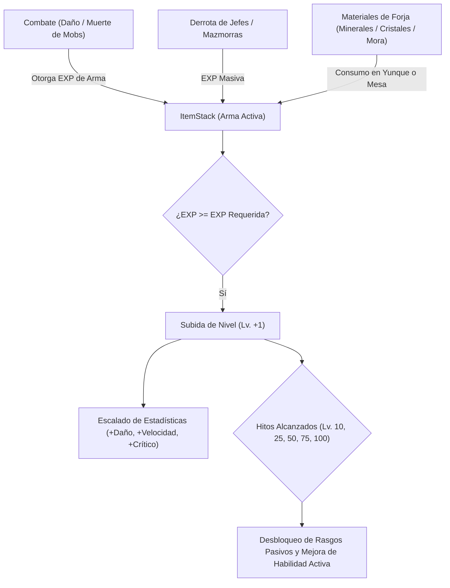
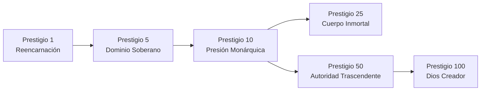
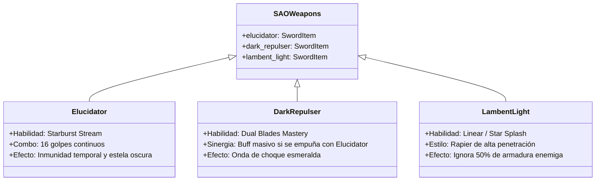

# 🌟 Plan Arquitectónico: Sistema de Nivel de Armas, Prestigio Ampliado, Auras 3D y Expansión Gacha

Este documento presenta el diseño técnico, la arquitectura de código y el plan de implementación paso a paso para las cinco grandes expansiones solicitadas:

1. **Sistema Universal de Subida de Nivel de Armas (Lv. 1 a 100)** para todas las armas del mod.
2. **Rebalanceo de Probabilidades de Gacha** (*Mandoble del Creador* y *La Doncella*).
3. **Ampliación Integral del Sistema de Prestigio (Prestigio 1 a 100)** con bonificadores permanentes y habilidades exclusivas.
4. **Motor de Auras Tridimensionales Dinámicas (Aura Engine)** estilo Dragon Ball (Super Saiyan) y Cultivo Ki (Translúcida Zen).
5. **Nuevos Compañeros de Juegos Gacha** (*Honkai: Star Rail*, *Zenless Zone Zero*, *Genshin Impact*, *Wuthering Waves*, *Neverness to Everness*).
6. **Armas Homenaje de Sword Art Online (SAO)** para tu amigo contribuidor (*Elucidator*, *Dark Repulser*, *Lambent Light*).

---

## 1. ⚔️ Sistema Universal de Subida de Nivel de Armas (Weapon Leveling System)

### 1.1. Arquitectura de Datos (`WeaponLevelData`)
En NeoForge 1.21.1, utilizaremos los **Data Components** de Minecraft (`DataComponents.CUSTOM_DATA` / componente personalizado) para almacenar el progreso de cada arma de forma persistente, sincronizada en red y visible en el cliente.



#### Estructura de Datos en NBT / Componente:
```json
{
  "WeaponLevel": 1,
  "WeaponExp": 0,
  "MaxExp": 120,
  "TotalKills": 0,
  "AwakenedTraits": [ "trait_mana_efficiency", "trait_critical_burst" ]
}
```

### 1.2. Curva de Experiencia y Progresión
* **Nivel Máximo**: Nivel 100.
* **Fórmula de EXP por Nivel**:
  $$\text{EXP Requerida}(L) = \lfloor 100 \times L^{1.35} \rfloor$$
  * *Nivel 1 $\to$ 2*: 100 EXP.
  * *Nivel 10 $\to$ 11*: ~2,240 EXP.
  * *Nivel 50 $\to$ 51*: ~20,000 EXP.
  * *Nivel 100*: Nivel Máximo Alcanzado (Corona de Trascendencia).

### 1.3. Fuentes de Experiencia del Arma
1. **Golpes en Combate**: Cada golpe infligido otorga EXP equivalente al $15\%$ del daño infligido.
2. **Eliminación de Enemigos**:
   * Enemigo común (Zombie, Esqueleto): $+35 \text{ EXP}$.
   * Enemigo Élite / Minijefe (Mitachurl, Minijefes del Overworld): $+250 \text{ EXP}$.
   * Jefes Supremos (Hipóstasis, Dragones Antiguos, Monolito del Abismo): $+2,500 \text{ EXP}$.
3. **Minerales de Mejora y Forja (Infusión Directa)**:
   * *Mineral de Mejora Místico*: $+500 \text{ EXP}$.
   * *Cristal de Purificación Espiritual*: $+2,500 \text{ EXP}$.
   * *Esencia del Dragón Ancestral*: $+10,000 \text{ EXP}$.

### 1.4. Escalado de Estadísticas del Arma
* **Daño de Ataque Base**: $+1.2\%$ por nivel ($+120\%$ de daño base a Lv. 100).
* **Velocidad de Ataque**: $+0.25\%$ por cada 5 niveles ($+5\%$ a Lv. 100).
* **Probabilidad de Golpe Crítico**: $+0.1\%$ por nivel ($+10\%$ a Lv. 100).
* **Penetración de Armadura**: Se desbloquea a partir de Nivel 30 ($+0.15\%$ por nivel hasta un $+15\%$).

### 1.5. Hitos de Despertar de Habilidades (Milestones)
* **Lv. 10 — Vínculo de Sangre**: Reduce en un $20\%$ el coste de Ki / Maná de las habilidades del arma.
* **Lv. 25 — Resonancia Marcial**: Los golpes críticos desatan una onda de choque cortante que golpea a enemigos cercanos infligiendo el $40\%$ del daño.
* **Lv. 50 — Despertar de Habilidad Activa**:
  * La habilidad activa de cada arma evoluciona visualmente y en poder:
    * *Mandoble del Creador*: Cataclismo del Génesis triplica el radio de impacto y ya no usa un círculo plano básico, sino una columna de gravedad estelar y pilares de luz celestial.
    * *La Doncella*: La doncella sombría invoca 3 cuchillas danzantes adicionales que buscan enemigos automáticamente.
    * *Armas Genshin*: El cooldown de la habilidad activa se reduce en un $30\%$ y genera explosiones elementales en cadena.
* **Lv. 75 — Resplandor del Alma (Aura de Arma)**: El arma desprende un aura luminosa tridimensional que fluye a lo largo de su filo en tercera y primera persona.
* **Lv. 100 — Trascendencia Absoluta**: Multiplicador de Daño Final $\times 1.5$ y desbloqueo de la habilidad definitiva sin coste adicional.

---

## 2. 🎰 Rebalanceo de Tasas del Gacha (*Mandoble del Creador* y *La Doncella*)

En `GachaManager.java`, se reducen las probabilidades a los nuevos rangos ultra-legendarios:

| Arma | Probabilidad Anterior | Nueva Probabilidad Diseñada | Tiradas Promedio Estimadas |
| :--- | :--- | :--- | :--- |
| **Mandoble del Creador** | $0.035\%$ (1 en ~2,857) | **$0.008\%$** (1 en ~12,500) | Ultra-Mítica de Rango Creador |
| **La Doncella** | $0.080\%$ (1 en ~1,250) | **$0.020\%$** (1 en ~5,000) | Reliquia Legendaria Despierta |

* Ambas armas comenzarán en **Nivel 1**, requiriendo ser mejoradas en combate para alcanzar su verdadero poder colosal en Nivel 100.

---

## 3. 👑 Expansión del Sistema de Prestigio (Prestigio 1 a 100)

### 3.1. Diagnóstico del Problema Actual
Actualmente, el prestigio tiene un tope rígido de **10** (`prestige < 10`), reinicia el jugador del nivel 1000 al 1, borra todas las estadísticas a 5 y borra todas las habilidades, dando únicamente un modesto bonus de monedas.

### 3.2. Nuevo Límite y Beneficios Permanentes Acumulables
* **Nuevo Límite de Prestigio**: **Prestigio 100**.
* Por cada nivel de Prestigio obtenido:
  1. **Base de Estadísticas Permanente (Atributos Base)**: En lugar de volver a 5, el jugador gana **$+2$ a todos los atributos base** por cada prestigio.
     * *Prestigio 0*: Fuerza/Vitalidad/etc. base = 5.
     * *Prestigio 10*: Atributos base = 25 (el jugador ya no es débil al nivel 1).
     * *Prestigio 50*: Atributos base = 105.
     * *Prestigio 100*: Atributos base = 205 permanentes.
  2. **Multiplicador de EXP Ganada**: **$+10\%$ de EXP permanente por prestigio**.
     * Prestigio 1: $+10\%$ EXP.
     * Prestigio 10: $+100\%$ EXP (el doble de velocidad para subir a nivel 1000).
     * Prestigio 50: $+500\%$ EXP.
  3. **Daño Final y Resistencia al Daño**:
     * $+1.5\%$ de Daño Final infligido por prestigio ($+150\%$ a Prestigio 100).
     * $+1.0\%$ de Reducción de Daño global por prestigio ($+50\%$ cap a Prestigio 50+).
  4. **Regeneración de Maná y Ki**: $+2\%$ más rápido por prestigio.

### 3.3. Hitos y Habilidades Exclusivas de Prestigio



* **Prestigio 1 — Alma Reencarnada**: Permite conservar **1 ranura de habilidad activa favorita** tras el reinicio del prestigio sin tener que esperar a desbloquearla.
* **Prestigio 5 — Dominio del Soberano**: $+10\%$ de probabilidad de Golpe Crítico permanente y los monstruos comunes tiemblan y se ralentizan en un radio de 8 bloques.
* **Prestigio 10 — Habilidad Exclusiva: *Presión Monárquica***:
  * Habilidad activa de enfriamiento medio: El jugador libera una onda de choque de gravedad absoluta en un radio de 16 bloques que estampa contra el suelo e inmoviliza a todos los enemigos durante 4 segundos.
* **Prestigio 25 — Cuerpo de Diamante Inmortal**:
  * Si el jugador recibe un golpe letal que lo mataría, en lugar de morir, se activa automáticamente una resurrección instantánea con el $50\%$ de salud y un escudo de invulnerabilidad de 3 segundos (enfriamiento: 10 minutos).
* **Prestigio 50 — Autoridad Trascendente**:
  * $+50\%$ a todo el poder de hechizos de *Iron's Spells 'n Spellbooks* y *Ars Nouveau*, y un $-20\%$ permanente a todos los enfriamientos de habilidades del sistema.
* **Prestigio 100 — Dios de la Creación (Trascendencia Suprema)**:
  * Título holográfico único: `«El Trascendente Supremo»`.
  * Aura Cósmica Divina permanente rodeando al jugador en tercera persona.
  * Multiplicador global de estadísticas $\times 2.0$.

---

## 4. 🌀 Motor de Auras Tridimensionales Dinámicas (Aura Visual Engine)

### 4.1. Reemplazo del Círculo Mágico Plano Tradicional
Las texturas de círculos planos en el suelo se reemplazan por un **Motor de Auras Tridimensional Volumétrico**:

```
           /|   |\          <-- Llamas de Energía Ondulantes (UV scrolling + deformación senoidal)
          / |   | \
         |  | o |  |        <-- Corona cilíndrica multicapa alrededor del jugador
         |  |/ \|  |
        /    ---    \       <-- Chispas y arcos eléctricos rotatorios (estilo Saiyan 2)
      ===========       <-- Anillo de choque de energía en el suelo (pulsación hacia afuera)
```

### 4.2. Tipos de Auras Diseñadas

| Tipo de Aura | Cuándo se Activa | Efecto Visual 3D | Paleta de Colores |
| :--- | :--- | :--- | :--- |
| **Aura de Cultivo / Ki** | Al meditar (`toggle_meditation`) o canalizar Qi marcial | Vórtice cilíndrico suave, translúcido, con hebras de energía que convergen hacia el dantian del jugador y ascienden suavemente | Blanco perlado, azul celeste cristalino y dorado tenue |
| **Aura Saiyan de Combate** | Al usar habilidades de Cazador / Furia marcial / Transformación | Columna de fuego de energía vertical con crestas puntiagudas (spikes) que ondulan violentamente, acompañada de relámpagos que crujen en el cuerpo | Dorado radiante (#FFD700), naranja flama (#FF8C00) con chispas azul eléctrico |
| **Aura de Sombras (Monarca)** | Clase Monarca de las Sombras / Extracción de Sombras | Niebla espesa y zarcillos sombríos que brotan del suelo bajo los pies y envuelven el torso, ojos con resplandor carmesí | Púrpura oscuro abisal (#4A0E4E) y negro niebla con destellos violeta |
| **Aura Celestial / Creador** | Al portar el Mandoble del Creador a nivel alto o Prestigio 50+ | Manto prismático estelar con polvo cósmico flotante y runas translúcidas orbitando | Amatista divino (#9D4EDD), oro celestial (#FFE066) |

### 4.3. Implementación Gráfica en NeoForge
* Renderizado a nivel de cliente mediante `RenderLevelStageEvent.AFTER_ENTITIES` o una capa dedicada `LivingEntityRenderer`.
* Geometría generada en tiempo real mediante VertexBuffer:
  * Cilindros concéntricos de 16 segmentos con vértices desplazados por funciones senoidales $\sin(t \cdot \omega + y \cdot k)$.
  * Texturas con mapeo UV en movimiento ascendente (`vOffset = (gameTime + partialTicks) * speed`).
  * Modo de mezcla aditiva (`RenderType.eyes` o `translucent`) para que brille intensamente en la oscuridad y atraviese sutilmente el modelo del jugador.

---

## 5. 👥 Nuevos Compañeros de Juegos Gacha (Companions Roster)

El usuario pidió añadir compañeros de juegos gacha reconocidos (*Honkai: Star Rail*, *Zenless Zone Zero*, *Genshin Impact*, *Wuthering Waves*, *Neverness to Everness*), con una regla clara:
> *"Si hay alguna skin, se añade; si no se encuentra skin, se descarta para evitar la complicación de crearla manualmente."*

### Lista de Candidatos Propuestos por Franquicia:

#### A. Honkai: Star Rail (HSR)
1. **Dan Heng • Imbibitor Lunae** (5★ — Imaginario / Destrucción): Desata el dragón Vidyadhara y ataques en ráfaga masivos.
2. **Feixiao** (5★ — Viento / Cacería): Gran general de Yaoqing con cortes de espada y hachas a velocidad vertiginosa.
3. **Aventurine** (5★ — Imaginario / Preservación): Escudo de la suerte, monedas doradas de la fortuna y contraataques automáticos.
4. **Robin** (5★ — Físico / Armonía): Concierto estelar que aumenta el ataque y daño de todo el equipo y reproduce música etérea.
*(Ya contamos en el mod con texturas para: `acheron.png`, `kafka.png`, `firefly.png`, `march_7th.png`).*

#### B. Zenless Zone Zero (ZZZ)
1. **Jane Doe** (5★ — Físico / Anomalía): Danza de estiletes, evasión perfecta y acumulación rápida de Asalto.
2. **Zhu Yuan** (5★ — Éter / Ataque): Oficial de seguridad con disparos tácticos de escopeta de éter a corta distancia.
3. **Caesar King** (5★ — Físico / Defensa): Escudo de gladiador, bloqueo perfecto y aumento de impacto para el jugador.
*(Ya contamos en el mod con texturas para: `ellen_joe.png`, `hoshimi_miyabi.png`).*

#### C. Wuthering Waves (WuWa)
1. **Jiyan** (5★ — Aero): Invoca al dragón Qingloong con ataques de lanza giratoria en espiral que barren la sala.
2. **Changli** (5★ — Fusión): Mentora de Jinzhou con ráfagas de espada de fuego y vuelo del fénix escarlata.
3. **Jinshi** (5★ — Espectro): Magistrada que canaliza el poder de Jué con rayos de luz divina.
4. **Yinlin** (5★ — Electro): Titiritera que controla la marioneta Zapstring provocando descargas eléctricas en cadena.

#### D. Genshin Impact
1. **Mavuika** (5★ — Pyro): La Arconte de Natlan con puñetazos ardientes y ráfagas solares.
2. **Kinich** (5★ — Dendro): Cazador con gancho acrobático y disparos de cañón del dragón Ajaw.
3. **Xilonen** (5★ — Geo): Patines de combate que reducen las defensas y resistencias de todos los enemigos.
4. **Clorinde** (5★ — Electro): Duelos de estoque y pistola con estocadas eléctricas de alta velocidad.
*(Ya contamos en el mod con texturas para: Raiden, Zhongli, Hu Tao, Furina, Nahida, Kazuha, Diluc, Jean, Bennett, Noelle, Columbina, Xiao, Arlecchino, Ganyu).*

#### E. Neverness to Everness (NTE)
1. **Mint** (5★ — Psíquico Urbano): Especialista en contención de anomalías y telequinesis.
2. **Nanally** (5★ — Éter Sobrenatural): Manipulación del espacio distorsionado.

*Nota de Flujo de Trabajo*:
* Se prepararán los perfiles en `CompanionProfile.java`.
* Si la textura/skin está disponible o el usuario la proporciona, se activa de inmediato. Si no se localiza la skin de un personaje concreto, se excluye limpiamente sin errores.

---

## 6. 🗡️ Armas Tributo de Sword Art Online (SAO)

En honor a la petición especial del amigo contribuidor de CurseForge, se añadirán tres armas míticas de SAO:



### 6.1. Elucidator (Espada de la Noche Negra — Kirito)
* **ID**: `elucidator`
* **Rareza**: 5★ (Mítica / Épica).
* **Daño Base**: 15 de daño, velocidad 1.6.
* **Habilidad Activa**: *Starburst Stream (Ráfaga de la Estrella Destellante)*:
  * El jugador entra en modo de ataque frenético durante 3 segundos, desatando una ráfaga de 16 cortes cortantes continuos en área frente a él, ganando resistencia total al retroceso y resistencia al daño mientras ataca.
* **Método de Obtención**:
  * Receta de forja con Lingotes de Netherite, Fragmentos de Alma Oscura y Núcleo de Dragón Ancestral, o como tirada 5★ en el Gacha de Armas.

### 6.2. Dark Repulser (Espada Ciclón Esmeralda — Kirito)
* **ID**: `dark_repulser`
* **Rareza**: 5★ (Mítica / Épica).
* **Daño Base**: 14 de daño, velocidad 1.8.
* **Sinergia Especial (*Dual Blades — Empuñadura Doble*)**:
  * Si el jugador empuña *Elucidator* en la mano principal y *Dark Repulser* en la mano secundaria:
    * Se activa la pasiva secreta: $+35\%$ de Daño Total, $+50\%$ de Velocidad de Ataque y los ataques liberan ráfagas cruzadas de luz cian y sombras oscuras.

### 6.3. Lambent Light (Luz Radiante / Rapier — Asuna)
* **ID**: `lambent_light`
* **Rareza**: 5★ (Mítica / Épica).
* **Daño Base**: 13 de daño, velocidad 2.2 (estoque ultra rápido).
* **Habilidad Activa**: *Linear (Estocada de Destello Lineal)*:
  * El jugador se propulsa 10 bloques en línea recta a la velocidad de la luz, atravesando a todos los enemigos en el camino, infligiendo daño masivo que **ignora el $50\%$ de la armadura** y desorientando a los objetivos durante 3 segundos.
* **Método de Obtención**:
  * Forja con Lingotes de Mithril, Plumas de Grulla Celestial y Diamantes Puros, o recompensa de rango en la Torre de Cazadores / Gacha.

---

## 7. 📅 Fases del Plan de Implementación

| Fase | Tarea Principal | Archivos Involucrados |
| :---: | :--- | :--- |
| **Fase 1** | **Subida de Nivel de Armas (Lv. 1-100)**: Componente de datos, cálculo de EXP en combate, escalado de daño y tooltips informativos con barra de progreso. | `AwakeningWeaponItem.java`, `WeaponLevelData.java`, `SystemEvents.java`, `SystemItems.java` |
| **Fase 2** | **Rebalanceo de Probabilidades de Gacha**: Ajuste a $0.008\%$ para Mandoble del Creador y $0.02\%$ para La Doncella. | `GachaManager.java` |
| **Fase 3** | **Expansión de Prestigio (1-100)**: Elevar tope a 100, implementar bonificadores de estadísticas base acumulables, multi de EXP y habilidades exclusivas de hito (P1, P5, P10, P25, P50, P100). | `SystemData.java`, `SystemEvents.java`, `SystemAttributeEffects.java`, `AwakeningSystemMod.java` |
| **Fase 4** | **Motor de Auras Tridimensionales (Aura Engine)**: Renderizado de aura volumétrica en 3D para cultivo de Ki (blanco translúcido), Saiyan (flama dorada) y habilidades de alto nivel. | `AuraRenderer.java`, `AwakeningSystemClient.java`, `PlayerAuraPayload.java` |
| **Fase 5** | **Armas de SAO**: Registro de *Elucidator*, *Dark Repulser* y *Lambent Light*, modelos, habilidades de combate y sinergia de doble empuñadura. | `SystemItems.java`, `SaoWeaponsItem.java`, texturas y modelos JSON |
| **Fase 6** | **Nuevos Compañeros Gacha**: Integración de perfiles candidatos en `CompanionProfile.java` y verificación de skins/modelos según disponibilidad. | `CompanionProfile.java`, `CompanionScreen.java`, texturas |
| **Fase 7** | **Compilación, Verificación y Exportación del JAR**: `gradlew build` y copia al directorio de mods de CurseForge. | Entorno de desarrollo |

---

## 8. ✅ Decisiones de Diseño Confirmadas por el Usuario

1. **Límite de Nivel de Armas**: **Nivel 100** (Progresión profunda tipo Solo Leveling con hitos en Lv. 10, 25, 50, 75 y 100).
2. **Obtención de Armas de SAO**: **Doble Vía** (Crafteo avanzado con recetas legendarias en forja + Aparición en Banners de Armas del Gacha).
3. **Activación de Auras Tridimensionales**: Activas tanto durante la **meditación en flor de loto / cultivo de Ki** (blanca/celeste translúcida) como durante **combate y habilidades de clase de cazador** (dorada llameante / sombría abisal).
4. **Política de Skins de Compañeros**: Se integrarán perfiles para los personajes propuestos (HSR, ZZZ, Genshin, WuWa, NTE). Si se dispone de la skin de Minecraft correspondiente se activa de inmediato; de lo contrario, se excluye limpiamente para evitar crear modelos/texturas incompletas.
